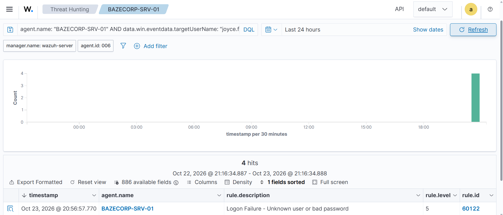
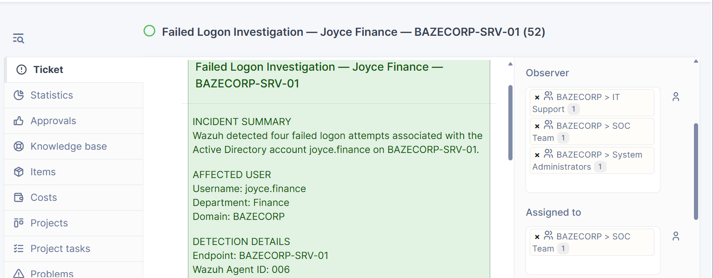
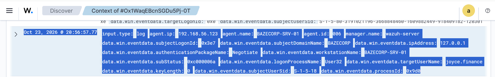
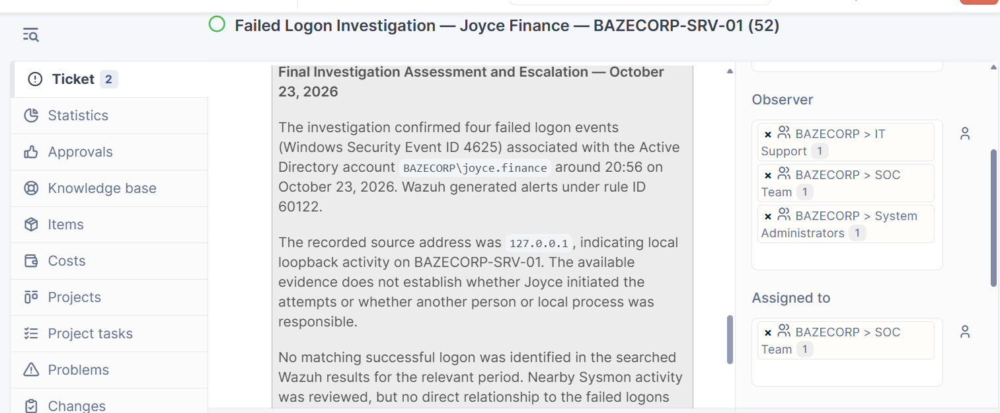

# BAZECORP SOC Operations

## Incident Response Case: BAZECORP-IR-2026-001

### Failed Logon Investigation — Joyce Finance

**Incident Date:** October 23, 2026  
**Affected Account:** `BAZECORP\joyce.finance`  
**Affected Endpoint:** `BAZECORP-SRV-01`  
**Wazuh Agent ID:** `006`  
**Windows Security Event ID:** `4625`  
**Wazuh Rule ID:** `60122`  
**GLPI Ticket:** #52  
**Status:** Escalated for follow-up and close monitoring

---

## Incident Summary

Wazuh detected four failed logon events associated with the Active Directory account `BAZECORP\joyce.finance` on `BAZECORP-SRV-01` at approximately 20:56 on October 23, 2026.

The events triggered Wazuh rule `60122`, titled **Logon Failure - Unknown user or bad password**. Review of the detailed Windows event data showed the source address as `127.0.0.1`, indicating loopback activity on the affected server.

The available evidence does not establish whether Joyce personally initiated the attempts or whether another person or a local process was responsible.

No matching successful logon was identified in the searched Wazuh results for the relevant period. This finding does not independently prove that no successful authentication occurred outside the results reviewed.

## Investigation Findings

- Four failed logon events were confirmed.
- The affected account was `BAZECORP\joyce.finance`.
- The endpoint recording the events was `BAZECORP-SRV-01`.
- The Windows Security Event ID was `4625`.
- Wazuh generated alerts under rule ID `60122`.
- The recorded source address was `127.0.0.1`.
- No matching successful logon was identified in the searched results for the relevant period.
- Nearby Sysmon and SMB-related alerts were reviewed, but no direct connection to Joyce's failed logons was established.
- The available evidence does not confirm account compromise or identify the person or process responsible.

## Incident Evidence

The following screenshots document the alert results, account search, GLPI ticket, detailed Windows event data, and final investigation assessment.

### Evidence 01 — Wazuh Failed-Logon Alerts

Wazuh alert results showing the four failed-logon events, timestamps, severity, and rule ID.


### Evidence 02 — Joyce Account Search Results

Wazuh search results filtered for the affected account and endpoint, showing the four matching events.



### Evidence 03 — GLPI Incident Ticket #52

GLPI ticket documenting the incident summary, affected account, investigation details, and assignment to the BAZECORP SOC Team.



### Evidence 04 — Detailed Windows Failed-Logon Event

Detailed Windows event data showing the affected account, event timestamp, source address, and authentication failure information.



### Evidence 05 — Final Investigation Assessment

GLPI follow-up documenting the investigation findings, limitations, escalation recommendation, and proposed remediation.



---

## Response and Remediation

The incident was escalated for follow-up because of the repeated authentication failures.

Recommended actions:

1. **Escalate the incident** to the SOC lead and BAZECORP IT administrators.
2. **Contact Joyce Finance** to verify whether she recognizes the authentication activity.
3. **Request a password change** for the affected account in accordance with organizational procedures.
4. **Place the account and endpoint under close monitoring** for further failed logons, unexpected successful authentications, or other suspicious activity.
5. **Retain the collected evidence** and document subsequent actions in GLPI ticket #52.

These actions are recommendations for follow-up and should not be interpreted as completed unless separately documented.

## Final Assessment

The investigation confirmed four failed authentication attempts against the `joyce.finance` account. The source address was recorded as `127.0.0.1`, and the available evidence did not establish who or what initiated the attempts.

No matching successful logon was identified in the searched Wazuh results for the relevant period. Account compromise was not confirmed.

**Disposition:** Escalated for follow-up. Request a password change through the appropriate organizational process and maintain close monitoring of the account and endpoint.

**Incident Reference:** `BAZECORP-IR-2026-001`  
**GLPI Ticket:** `#52`

---

## Repository Structure

```text
bazecorp-soc-operations/
├── README.md
├── BAZECORP-IR-2026-001_Evidence-01_Wazuh-Failed-Logon-Alerts.png
├── BAZECORP-IR-2026-001_Evidence-02_Wazuh-Joyce-Failed-Logon-Search.png
├── BAZECORP-IR-2026-001_Evidence-03_GLPI-Incident-Ticket-52.png
├── BAZECORP-IR-2026-001_Evidence-04_Windows-Failed-Logon-Joyce-Details.png
└── BAZECORP-IR-2026-001_Evidence-05_GLPI-Investigation-Assessment.png
