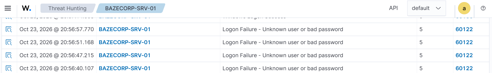

# BAZECORP | Security Operations Center

### Security Monitoring • Threat Detection • Incident Investigation • Incident Response

Welcome to the BAZECORP Security Operations Center (SOC) operations repository.

This repository documents security monitoring activities, threat detection, incident investigations, evidence analysis, incident handling, and response recommendations within the BAZECORP environment.

The objective is to maintain structured, evidence-based security records that support incident investigation, escalation, remediation, and continuous improvement of security operations.

---

## 🛡️ SOC Operations Overview

| Function | Description |
|---|---|
| Security Monitoring | Monitor endpoint and security events for suspicious activity. |
| Threat Detection | Review security alerts and investigate potentially malicious behavior. |
| Incident Investigation | Analyze authentication events, endpoint telemetry, and relevant evidence. |
| Incident Response | Document findings, escalation decisions, and recommended remediation. |
| Evidence Management | Preserve screenshots and investigation records for traceability. |
| Incident Documentation | Maintain structured reports and incident records for operational review. |

---

## 🧰 Security Monitoring Environment

The documented environment includes the following technologies:

- **Wazuh SIEM** — Security alert monitoring and event investigation.
- **Windows Server / Active Directory** — Windows authentication events and domain account activity.
- **Sysmon** — Endpoint telemetry supporting process and network activity investigations.
- **GLPI** — Incident ticketing, assignment, and investigation documentation.

*Technologies are listed according to their use in the documented investigation.*

---

## 🚨 Incident Report: IR-2026-001

### Joyce Finance — Failed-Logon Investigation

| Field | Details |
|---|---|
| Incident Date | October 23, 2026 |
| Affected Account | `BAZECORP\joyce.finance` |
| Endpoint | `BAZECORP-SRV-01` |
| Wazuh Agent ID | `006` |
| Windows Security Event ID | `4625` |
| Wazuh Rule ID | `60122` |
| GLPI Ticket | #52 |
| Disposition | Escalated for follow-up |

### Incident Summary

Wazuh identified four failed logon events associated with the `joyce.finance` Active Directory account on `BAZECORP-SRV-01` at approximately 20:56 on October 23, 2026.

The events were classified as logon failures associated with an unknown user or incorrect password. Detailed event evidence recorded the source address as `127.0.0.1`, indicating loopback activity on the endpoint.

### Investigation Findings

- Four failed authentication events were identified for the affected account.
- Windows Security Event ID `4625` and Wazuh rule `60122` were associated with the alerts.
- The recorded source address was `127.0.0.1`.
- The available evidence does not establish whether Joyce personally initiated the attempts or whether another person or local process was responsible.
- No matching successful logon was identified in the searched Wazuh results for the relevant period.
- Nearby Sysmon activity was reviewed, but no direct relationship to the failed logons was established.

### Recommended Response and Remediation

1. Escalate the incident to the SOC lead and relevant IT administrators.
2. Contact Joyce to verify whether the authentication attempts were expected.
3. Request a password change in accordance with organizational procedures.
4. Maintain close monitoring of the affected account and endpoint for further suspicious authentication activity.
5. Document follow-up actions and update GLPI ticket #52 as remediation progresses.

**Final assessment:** The repeated authentication failures warrant escalation. Account compromise has not been confirmed by the available evidence.

**Incident tracking:** GLPI ticket #52.

---

## 📸 Incident Evidence

The following screenshots provide visual evidence supporting the investigation. Select an image to view it at full size.

### Evidence 01 — Wazuh Failed-Logon Alerts



### Evidence 02 — Joyce Account Search Results


### Evidence 03 — GLPI Incident Ticket


### Evidence 04 — Detailed Failed-Logon Event


### Evidence 05 — Final Investigation Assessment


The GLPI follow-up documenting the final assessment, investigation limitations, and escalation recommendation.


---

## 📁 Repository Structure

```text
bazecorp-soc-operations/
├── README.md
├── BAZECORP-IR-2026-001_Evidence-01_Wazuh-Failed-Logon-Alerts.png
├── BAZECORP-IR-2026-001_Evidence-02_Joyce-Account-Search-Results.png
├── BAZECORP-IR-2026-001_Evidence-03_GLPI-Incident-Ticket.png
├── BAZECORP-IR-2026-001_Evidence-04_Detailed-Failed-Logon-Event.png
└── BAZECORP-IR-2026-001_Evidence-05_Final-Investigation-Assessment.png
